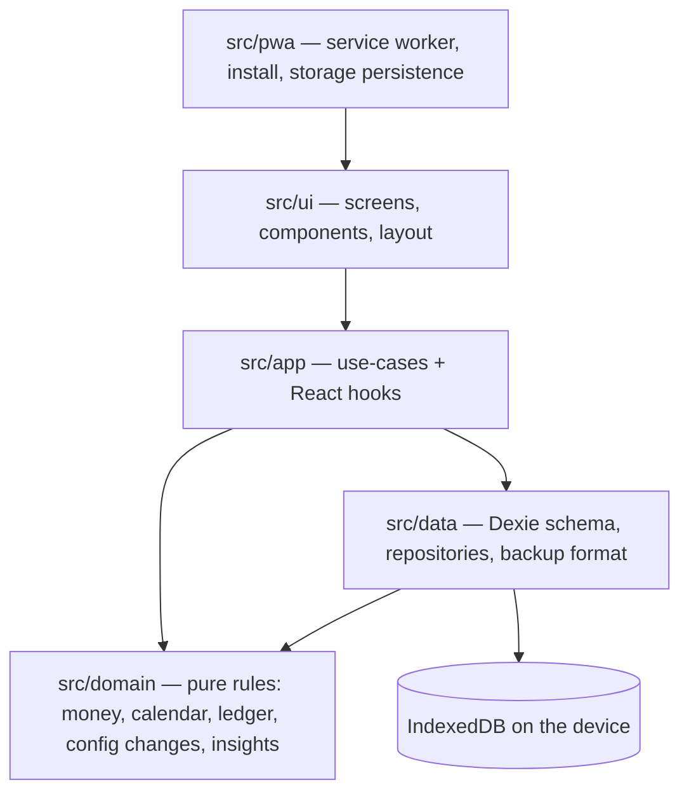

# Architecture

> Status: **target architecture**. Folders and files described here are created by the tasks in
> [the build plan](plan/README.md). When a task builds something, it updates this doc to match reality.

## 1. Decisions at a glance

| Question               | Decision                                                                                     | Why                                                                                                           |
| ---------------------- | -------------------------------------------------------------------------------------------- | ------------------------------------------------------------------------------------------------------------- |
| Native app or web app? | **Native iOS App (`ios/`)** via TestFlight/App Store + **Web/PWA preview**                   | Native iOS `Application Support` storage cannot be wiped by clearing Safari cache; fast Linux dev.            |
| Runtime dependencies   | **`react` and `react-dom` ONLY** (zero extra runtime packages)                               | Smallest bundle, zero supply-chain bloat on the phone, total control.                                         |
| UI framework           | **React 19 + TypeScript (strict)**, built with **Vite**                                      | Mature, fast, every agent knows it.                                                                           |
| Styling                | **Native CSS custom properties** (`tokens.css` (planned until T04) + CSS)                    | Fast, zero external CSS framework runtime, tokens keep the look consistent.                                   |
| Local database         | **Native iOS `Application Support` file bridge** + **browser `IndexedDB` API**               | Immune to Safari cache resets on iOS; indexed fast queries & transactions in `src/data/` (planned until T03). |
| Validation             | **Pure TypeScript validators**                                                               | Validates import files and form input with readable errors and zero dependencies.                             |
| Offline / install      | **Embedded native iOS bundle (`simplebudget://app/`)** + **Service Worker (`public/sw.js`)** | 100% embedded inside `.ipa` on iOS, plus offline-ready web preview on GitHub Pages.                           |
| Routing                | **Native hash routing** (`#/`, `#/insights`, `#/settings`)                                   | ~25 lines using `window.location.hash` + `hashchange`; works in both native iOS `WKWebView` and web.          |
| Bottom sheets          | **Native HTML `<dialog>`** + CSS transitions                                                 | Built-in accessibility, focus trap, and `Escape` handling; drawer in compact, modal unfolded.                 |
| Icons                  | **Inline SVG components**                                                                    | Clean, crisp line icons with zero external icon package.                                                      |
| Unit tests             | **Vitest** + **fast-check** (property tests) + **fake-indexeddb**                            | Dev-only packages; fast, readable, and property tests catch money edge cases.                                 |
| End-to-end             | **Playwright** on **WebKit** (Safari's engine) and Chromium                                  | Dev-only; WebKit is the closest thing to iPhone WebKit on Linux.                                              |
| Release & Hosting      | **GitHub Actions `macos-15` → TestFlight/App Store** + **GitHub Pages preview**              | Compiles native `.ipa` in Xcode on free public macOS runners from Linux; hosts web preview for free.          |
| Dates                  | Plain `"YYYY-MM-DD"` strings + a small tested calendar module                                | `Temporal` is not in iOS Safari; strings avoid timezone bugs.                                                 |
| Money                  | Integer cents, branded `Cents` type                                                          | Floats can't represent 0.10 exactly. Budgets must be exact.                                                   |

### ADR-1: Native iOS Wrapper (`ios/`) + Web Core (Developed on Linux, Built on GitHub Actions `macos-15`)

- **Why a Native iOS App (`ios/`):** In a browser or Home Screen PWA, going to **iOS Settings → Safari → Clear History and Website Data** can wipe WebKit storage. By wrapping the compiled Vite bundle inside a zero-dependency native Swift iOS app ([`ios/SimpleBudget/BudgetViewController.swift`](../ios/SimpleBudget/BudgetViewController.swift)), the app stores its database atomically inside iOS `Application Support` (with an automatic backup copy), which is **100% isolated from Safari** and **automatically included in iOS device/iCloud backups**.
- **How we build for iOS from Linux:** The owner develops on Linux (`pnpm dev`, `pnpm verify`). Because the repository is public on GitHub, GitHub Actions provides **unlimited free `macos-15` (macOS + Xcode) runner minutes** that run `scripts/build-ios.sh` (`xcodegen` + `xcodebuild`), compile the native iOS app on every commit, and sign + upload the `.ipa` binary to **TestFlight / App Store Connect** on every `v*` release tag.
- **Zero extra npm dependencies:** Unlike Capacitor (which adds runtime npm dependencies), `ios/` is ~150 lines of pure Swift using `WKURLSchemeHandler` (`simplebudget://app/`) and `WKScriptMessageHandlerWithReply` (`window.webkit.messageHandlers.nativeStorage`), keeping `package.json` `"dependencies"` strictly `react` and `react-dom`.

### ADR-2: Dexie/IndexedDB instead of SQLite-in-WebAssembly

The dataset is tiny (≈100–200 entries/month → ~2,400/year). IndexedDB with the right indexes answers
every query in single-digit milliseconds, and Dexie adds transactions, compound/multi-entry indexes and
live queries that re-render React automatically. SQLite WASM would add ~1 MB of WebAssembly and OPFS
complexity on iOS for no user-visible gain. The repository layer in `src/data/` (planned) isolates storage, so
switching later is contained.

## 2. Layers



Rules:

- `src/domain/` (planned) imports nothing from the other layers, has no I/O, and is where the money math lives.
  Everything in it is unit-tested, including property tests.
- `src/data/` (planned) never contains business decisions — it stores and fetches.
- `src/app/` (planned) is where a user intention ("add an expense", "change income starting next month") becomes
  domain calls + one database transaction. **Every write is a single Dexie transaction** so a failure
  can never leave half-written data.
- `src/ui/` (planned) reads through hooks (`useLiveQuery`) and writes only through `src/app/` use-cases.
- Time and ids are injected (`Clock`, `IdGenerator`) so tests are deterministic. Ids use
  `crypto.getRandomValues` (works over plain-HTTP LAN dev too; `crypto.randomUUID` does not).

## 3. Folder structure (target)

```text
config/
  devices.ts              Device viewport profiles (iPhone Duo folded/unfolded, others) — used by Playwright + device wall
dev/
  devices.html            Dev-only "device wall": the app in side-by-side frames at every profile size
e2e/
  journeys/               One *.spec.ts per feature; each test reads like a user story
  support/                budget-app.ts (the readable driver), custom matchers, fixtures
  fixtures/backups/       Backup files used to load history through the real import feature
public/                   Icons, apple-touch-icon, manifest assets
scripts/                  verify.sh, check-docs.sh, e2e container runner, fixture generators
src/
  domain/                 money.ts, calendar.ts, ledger.ts, budget-plan-changes.ts, insights.ts, tags.ts (+ *.test.ts)
  data/                   database.ts (Dexie schema & versions), repositories/, backup/ (export, import, migrations)
  app/                    use-cases/, providers (clock, ids), hooks/
  ui/
    theme/                tokens.css, global.css
    layout/               AppShell, TwoPane (hinge-aware), useLayoutMode, safe areas
    components/           Button, Sheet, MoneyField, TagPicker, AmountText, MonthCalendar, Toast…
    screens/              setup/, month/, insights/, settings/
  pwa/                    register-service-worker.ts, install-guide, storage-persistence.ts
  main.tsx
```

Unit tests sit next to the code they test (`money.ts` + `money.test.ts`) (planned until T02).

## 4. Data model (Dexie schema v1)

```ts
type Cents = number & { readonly __brand: 'Cents' }; // integer, may be negative in ledger entries
type IsoDate = string; // "2026-11-05" — local calendar date
type MonthKey = string; // "2026-11"

interface Settings {
  // table: settings (single row, id = 'app')
  id: 'app';
  currency: 'USD';
  locale: string; // e.g. 'en-US'
  weekStartsOn: 0 | 1; // 0 = Sunday
  setupCompletedAt: string | null;
  lastBackupAt: string | null;
}

interface Tag {
  // table: tags
  id: string;
  name: string; // display name, trimmed
  nameKey: string; // lower-cased name, unique (case-insensitive uniqueness)
  color: string; // token name from the tag palette
  createdAt: string;
}

interface RecurringItem {
  // table: recurringItems — the budget plan
  id: string;
  kind: 'income' | 'expense';
  name: string;
  amount: Cents; // always positive; kind decides the sign
  tagIds: string[];
  startMonth: MonthKey; // first month it is snapshotted into
  endMonth: MonthKey | null; // last month (inclusive); null = ongoing
  createdAt: string;
  updatedAt: string;
}

interface LedgerEntry {
  // table: entries
  id: string;
  date: IsoDate;
  monthKey: MonthKey; // always derived from date
  amount: Cents; // signed: + adds to budget, − subtracts
  name: string;
  note: string;
  tagIds: string[];
  source: 'manual' | 'recurring' | 'adjustment';
  recurringItemId: string | null; // set for 'recurring' and 'adjustment'
  recurrenceKey?: string; // `${monthKey}:${recurringItemId}`, only on 'recurring' → unique
  adjustment?: {
    change: 'amount-changed' | 'added' | 'removed';
    from: Cents | null;
    to: Cents | null;
  };
  createdAt: string;
  updatedAt: string;
}

interface OpenedMonth {
  // table: months
  monthKey: MonthKey; // primary key
  openedAt: string;
}
```

Dexie store definitions:

```ts
db.version(1).stores({
  settings: 'id',
  tags: 'id, &nameKey',
  recurringItems: 'id, kind, startMonth, endMonth',
  entries: 'id, monthKey, date, [monthKey+date], source, recurringItemId, &recurrenceKey, *tagIds',
  months: 'monthKey',
});
```

- `monthKey` index → "everything in November" and "everything before November" are index range scans.
- `*tagIds` multi-entry index → "everything tagged Groceries" without scanning.
- `&recurrenceKey` unique index → a recurring line can **never** be snapshotted twice into a month,
  even if two tabs race (entries without the key are not indexed, so manual lines are unaffected).

## 5. Key flows

### 5.1 First-run setup

1. User enters monthly income and recurring expenses (each with optional tags).
2. One transaction: write settings (`setupCompletedAt`), write recurring items with
   `startMonth = current month`, **open the current month**.
3. The month screen shows: _Carried over from {previous month}_ `$0.00`, _Monthly income_ `+`,
   each recurring expense `−`, and the **current budget**.

### 5.2 Opening months (rollover)

Runs on startup, whenever the app becomes visible again, and at local midnight while open.

```text
target = month of today (device local time)
last   = newest row in `months` (nothing to do if setup isn't complete)
for each month m after last, up to and including target:          // fills gaps if the app wasn't opened
  in ONE transaction:
    for each recurring item active in m (startMonth ≤ m ≤ endMonth?):
      add entry { source: 'recurring', date: first day of m, recurrenceKey: m:itemId } unless it exists
    add months row m
```

- **Idempotent:** running it 100 times changes nothing after the first.
- **Carried over is derived, never stored:** `carriedOver(m) = sum(amount of every entry with monthKey < m)`.
  Editing an old entry therefore corrects every later month automatically.
- If the clock moves backwards, nothing is deleted; the app simply shows the clock's month.

### 5.3 Changing the budget plan ("this month" vs "starting next month")

Any change that affects money (income amount, expense amount, adding or removing a recurring expense)
asks: **This month (November)** or **Starting next month (December)**.

| Change          | Starting next month                                                             | This month                                                                          |
| --------------- | ------------------------------------------------------------------------------- | ----------------------------------------------------------------------------------- |
| Amount changed  | Item's `amount` updated; November untouched; December snapshots the new amount. | Same update **plus** an _Adjustment_ line in November for the difference.           |
| Expense added   | New item with `startMonth = December`.                                          | Same **plus** an _Adjustment_ line `−amount` in November.                           |
| Expense removed | `endMonth = November` (stays this month, gone from December).                   | `endMonth = November` **plus** an _Adjustment_ line `+amount` (refund) in November. |

- The month's snapshot lines are never rewritten; the adjustment line tells the story
  (e.g. _Monthly income changed \$5,000.00 → \$5,500.00_ `+$500.00`).
- The difference is always computed against the amount **in effect this month**
  (snapshot + earlier adjustments for that item), so changing an amount twice in one month nets out correctly.
- Name and tag edits don't affect money: no prompt; they apply to the plan and to this month's
  recurring line for that item. Past months keep their history.
- All of this is a pure function in `src/domain/` (planned) returning `{ planUpdates, entriesToAdd }`; the use-case just persists it.

### 5.4 Manual expenses & deposits

Expense → negative amount, Deposit → positive amount. Date defaults to today; the month is derived from
the date. Edits and deletes are allowed (delete has an _Undo_ toast). Recurring and adjustment lines are
not editable from the ledger — the UI points to Settings so the plan stays the source of truth.

## 6. Storage durability (your data must not vanish)

- Home Screen web apps on iOS are **exempt** from Safari's 7-day storage eviction. Browser tabs are not.
  The app detects when it is running in a Safari tab and shows an install guide.
- Safari tabs and the Home Screen app have **separate storage**. Do setup inside the installed app.
- The app calls `navigator.storage.persist()` and shows the result in Settings → Data.
- **Silent Background Local Auto-Backup (T09):** Every write to `IndexedDB` silently mirrors a complete JSON backup into the browser's Origin Private File System (`navigator.storage.getDirectory()`) and `localStorage` (`simple-budget:auto-backup:latest`), and silently freezes `simple-budget:auto-backup:pre-update` before any app version or database schema upgrade. If `IndexedDB` is ever empty or corrupted, the app auto-recovers silently from the mirror with zero popups.
- **Manual Export Backup (T09):** Settings → Data provides a manual **Export backup** button (`navigator.share({ files })` or file download) and displays when a backup was last exported (`lastBackupAt`), without ever nagging the user with automatic popups or banners.
- Before an import replaces data, a safety snapshot is kept in the database so the import can be undone.

## 7. Backup format (export/import)

```json
{
  "app": "simple-budget",
  "schemaVersion": 1,
  "exportedAt": "2026-11-30T21:14:03.000Z",
  "data": {
    "settings": { "...": "..." },
    "tags": [],
    "recurringItems": [],
    "entries": [],
    "months": []
  }
}
```

- Validated with a pure TypeScript validator (types, integer cents, valid dates, `monthKey` matches `date`, every `tagId` and
  `recurringItemId` reference exists). Any problem → rejected with a clear message, nothing changes.
- Older `schemaVersion`s are migrated forward step by step (`v1 → v2 → …`) before validation.
- Import **replaces** all data in one transaction after showing a preview (counts and date range).
- Round-trip guarantee (property-tested): `import(export(data))` reproduces `data` exactly.
- CSV export of ledger entries is also offered for spreadsheets (one-way, not importable).

## 8. Performance budget

| Operation (10 years of data, ~25,000 entries, WebKit) | Budget   |
| ----------------------------------------------------- | -------- |
| Month screen data (carried over + month lines)        | < 30 ms  |
| Insights for "All time"                               | < 100 ms |
| Add expense → current budget updated on screen        | < 50 ms  |
| Cold start to interactive (installed, offline)        | < 1 s    |

All queries use indexes. If a budget is ever missed, add a `monthTotals` cache table maintained in the
same transaction as writes — but only with a test proving it equals the derived value.
