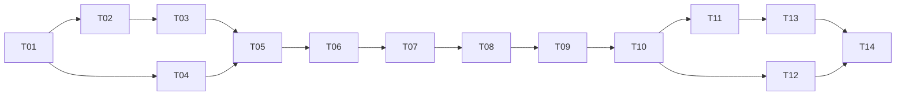

# Build plan

Each task is sized for one agent session and ends in a verified, committed, working state.
Work them **in order**. Agents: use the `work-next-plan-task` skill.

Statuses: `todo` → `in-progress` → `done`.

| #   | Task                                                                         | Depends on | Milestone                   | Status |
| --- | ---------------------------------------------------------------------------- | ---------- | --------------------------- | ------ |
| T01 | [Toolchain, test harness & CI](T01-toolchain-and-ci.md)                      | —          | Foundation                  | done   |
| T02 | [Domain core: money, calendar, ledger math](T02-domain-core.md)              | T01        | Foundation                  | done   |
| T03 | [Local database & repositories](T03-local-database.md)                       | T02        | Foundation                  | done        |
| T04 | [Design system & responsive app shell](T04-design-system-and-shell.md)       | T01        | Foundation                  | done        |
| T05 | [First-run setup & month ledger](T05-first-run-setup-and-ledger.md)          | T03, T04   | MVP                         | done        |
| T06 | [Manual expenses & deposits](T06-manual-expenses-and-deposits.md)            | T05        | MVP                         | done        |
| T07 | [Monthly rollover](T07-monthly-rollover.md)                                  | T06        | MVP                         | todo   |
| T08 | [Budget plan changes (this month vs next month)](T08-budget-plan-changes.md) | T07        | MVP                         | todo   |
| T09 | [Export, import & backups](T09-export-import-backups.md)                     | T08        | MVP                         | todo   |
| T10 | [Installable offline PWA & free deployment](T10-pwa-and-deployment.md)       | T09        | 🎯 **MVP — start using it** | todo   |
| T11 | [Tags](T11-tags.md)                                                          | T10        | Full app                    | todo   |
| T12 | [Calendar](T12-calendar.md)                                                  | T10        | Full app                    | todo   |
| T13 | [Insights: spending by tag & trends](T13-insights.md)                        | T11        | Full app                    | todo   |
| T14 | [Hardening: performance, accessibility, resilience](T14-hardening.md)        | T12, T13   | Release                     | todo   |

## Why this order

- **Foundation first** (T01–T04): tests and the money/calendar rules exist before any screen uses them.
- **MVP by T10**: after T10 the owner can install the app on the iPhone and run a real month with it:
  setup, expenses/deposits, rollover, plan changes, backups, offline. That's everything needed to not get evicted.
- **Tags, calendar, insights** (T11–T13) build on a stable core. The data model already stores `tagIds`
  from T03, so adding tags needs no migration.
- **Hardening** (T14) proves performance on 10 years of data and audits accessibility and resilience.

## Every task file has

- **Goal** and **Read first**
- **Scope** (in / out — out-of-scope items belong to a later task)
- **Steps** — a suggested route, not a cage
- **Behaviors to prove** — each bullet becomes a test with (nearly) that exact name
- **Acceptance criteria** — checkboxes the agent ticks only when truly met
- **Docs to update**
- **Completion notes** — filled in by the agent when done

## Decisions to confirm with the owner (defaults are used until told otherwise)

| Question                                            | Default                                                             |
| --------------------------------------------------- | ------------------------------------------------------------------- |
| Will the GitHub repo be public? (free GitHub Pages) | Yes → GitHub Pages. If private → Cloudflare Pages.                  |
| Week starts on                                      | Sunday (changeable in Settings, T12)                                |
| Currency                                            | USD only for now (format via `Intl`, so adding more later is easy)  |
| Name/tag edits to a recurring expense               | Apply immediately to this month's line and future months, no prompt |
| Entries in past months                              | Allowed to add/edit; later carry-overs update automatically         |
