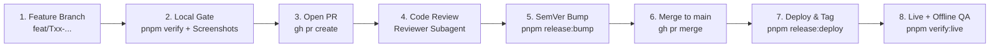

# Engineering, Release & Multi-Agent Workflow

Simple Budget follows a production software engineering workflow so both human contributors and AI agents
work with clear boundaries, peer review, automated Semantic Versioning, live deployment, post-deploy QA,
and one-command rollback.

## 1. Canonical Repository & Live Deployment

- **GitHub Repository:** `TandyN/simple-budget-app` (`https://github.com/TandyN/simple-budget-app`)
- **Live PWA URL (GitHub Pages):** `https://tandyn.github.io/simple-budget-app/`
- **Live Version Metadata:** `https://tandyn.github.io/simple-budget-app/version.json`
- **GitHub Actions / Pages Cost:** Because `TandyN/simple-budget-app` is a public repository, GitHub Actions
  standard Linux runners and GitHub Pages hosting are **100% free with unlimited minutes**. (All user budget
  data lives only in IndexedDB on the user's phone, never in the repo or on GitHub.)

> ⚠️ **Guardrail:** Agents must verify `git remote get-url origin` points to `TandyN/simple-budget-app`
> before pushing branches, creating PRs, or deploying.

## 2. Non-Negotiable Repository Policies

1. **Human-Only Section in `README.md`:**
   - Everything at the top of `README.md` under `# Human Description` (above `# Simple Budget`) belongs
     exclusively to the human owner.
   - Agents must **never** edit, reword, format, or delete anything above `# Simple Budget`.
   - `scripts/check-docs.sh` mechanically compares the `# Human Description` section against the most recent
     human commit (any commit without `(agent-generated)`) and fails the build if a single character changed.
2. **Agent Commit Signature (`(agent-generated)`):**
   - Every commit authored by an AI agent **must** end its subject line (and its commit body, if multi-line)
     with `(agent-generated)`.
   - Human commits do **not** include `(agent-generated)`.
   - Use the `agent-commit` skill for every commit.
3. **Zero Extra Runtime Dependencies (`react` and `react-dom` only):**
   - When installed on the phone, the production bundle must be a pure React app.
   - `package.json` `"dependencies"` may contain **only** `react` and `react-dom` (enforced mechanically by
     `scripts/check-docs.sh`).
   - Storage uses the browser's native IndexedDB API (`src/data/` (planned until T03)), routing uses native hash routing,
     sheets use native `<dialog>`, icons use inline SVGs, styling uses native CSS custom properties, and
     offline support uses our standard Service Worker (`public/sw.js`).
   - Well-tested developer tools (`typescript`, `vite`, `vitest`, `@playwright/test`, `eslint`, `prettier`,
     `fast-check`, `fake-indexeddb`, `lefthook`) are allowed in `"devDependencies"` only.

## 3. Semantic Versioning (`0.y.z` Pre-1.0 → `1.0.0`)

- During initial development (tasks T01–T13), versions follow SemVer `0.y.z`:
  - `feat(...)` commits bump the **minor** version (`0.1.0` → `0.2.0`).
  - `fix(...)`, `perf(...)`, `refactor(...)`, `docs(...)` commits bump the **patch** version (`0.1.0` → `0.1.1`).
- Upon completing T14 (Hardening & Release), the app bumps to **`1.0.0`**.
- `pnpm release:bump` (`scripts/release-version.mjs`) automatically calculates the next SemVer version from
  Conventional Commits since the last `v*` git tag and updates `package.json` and `CHANGELOG.md`.
- Every build embeds `__APP_VERSION__` in the UI footer and emits `dist/version.json` with `{ version, commit, builtAt }`.

## 4. End-to-End Feature Lifecycle



1. **Branch:** Create a topic branch from `main` (`git checkout -b feat/T02-domain-core`).
2. **Implement & Verify Locally:** Follow `work-next-plan-task`, `write-readable-tests`, `keep-docs-accurate`,
   and `verify-before-commit`. Commit using `agent-commit`.
3. **Open Pull Request:** Push the branch to `origin` and open a PR against `main` via `gh pr create`.
4. **Independent Review:** Run the `review-pr` skill (ideally via a dedicated `reviewer` subagent) to inspect
   `gh pr diff` against all golden rules and post a structured review on the PR.
5. **Version Bump & Changelog:** Run `pnpm release:bump` (`scripts/release-version.mjs`) and commit the
   `package.json` + `CHANGELOG.md` update to the branch.
6. **Wait for GitHub Actions CI & Troubleshoot Failures:** Run `gh pr checks <pr-number> --watch --repo TandyN/simple-budget-app`
   and wait for both the Ubuntu `verify` job and the macOS `ios-simulator` Xcode build job to succeed. If any CI job fails,
   inspect `gh run view <run-id> --repo TandyN/simple-budget-app --log-failed`, fix the issue on the branch, and re-verify
   before merging.
7. **Merge:** Merge the PR into `main` (`gh pr merge --merge --delete-branch`) and pull `main`.
8. **Deploy & Release:** Run `pnpm release:deploy` (`scripts/deploy.sh`), which builds `dist/`, pushes to
   `gh-pages`, ensures GitHub Pages is active, tags `vX.Y.Z`, and creates the GitHub Release.
9. **Post-Deploy Live & Offline QA:** Run `pnpm verify:live` (`scripts/verify-live.mjs`), which waits for
   `https://tandyn.github.io/simple-budget-app/version.json` to report the new version, opens the live site
   in Playwright WebKit at both `iphone-duo-folded` and `iphone-duo-unfolded` viewports, and reloads the live
   site in **offline mode** (`context.setOffline(true)`) to prove offline PWA functionality.

## 5. Instant Rollback

If a live release ever needs to be rolled back:

```bash
pnpm release:rollback v0.1.0
```

`scripts/rollback.sh` checks out the target `v*` tag in a clean temporary worktree, builds and deploys it to
`gh-pages`, and runs `pnpm verify:live --expect-version 0.1.0` to confirm the rollback is live.

## 6. Multi-Agent Personas & Parallel Task Orchestration

Using the `orchestrate-tasks` skill, an orchestrator agent can define and coordinate three specialized subagent roles:

| Persona       | Role                                                                                                                    |
| ------------- | ----------------------------------------------------------------------------------------------------------------------- |
| `implementer` | Works on an isolated branch (`Workspace: 'branch'` or `'share'`), writes readable tests, implements the task, verifies. |
| `reviewer`    | Read-only/review focus: audits `gh pr diff` against all golden rules, test readability, and zero-runtime-deps policy.   |
| `release-qa`  | Bumps SemVer/changelog, merges approved PRs, deploys to GitHub Pages, and runs `pnpm verify:live`.                      |

Tasks without shared dependencies in `docs/plan/README.md` can be developed in parallel on separate branches:

- **Parallel Pair 1 (after T01):** `T02 → T03` (Domain Core & Local Database) in parallel with `T04` (Design System & App Shell).
- **Parallel Pair 2 (after T10):** `T11 → T13` (Tags & Insights) in parallel with `T12` (Calendar).
