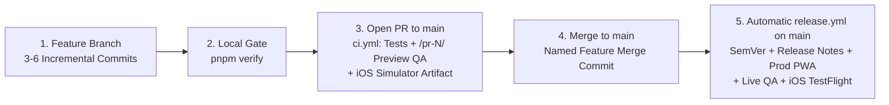

# Engineering, Release & Multi-Agent Workflow

Simple Budget follows a **Trunk-Based Development** workflow with two dedicated GitHub Actions pipelines:

1. **`.github/workflows/ci.yml` (Pull Request Verification & Isolated Preview QA):** Runs on every PR to `main` — verifies the branch is up to date with `main`, runs all unit/property and Playwright E2E tests, deploys an isolated preview to `https://tandyn.github.io/simple-budget-app/pr-<N>/`, runs live WebKit + offline QA against that isolated preview, and compiles + uploads a downloadable `SimpleBudget-iOS-Simulator` `.app` artifact.
2. **`.github/workflows/release.yml` (Automated Production Release & iOS Deployment):** Runs automatically whenever a PR is merged into `main` — calculates the next SemVer version and release notes from Conventional Commits, deploys the production PWA to `https://tandyn.github.io/simple-budget-app/`, verifies it live, commits/tags `vX.Y.Z`, creates the official GitHub Release, and triggers the macOS `ios-testflight` upload.

## 1. Canonical Repository & Environments

- **GitHub Repository:** `TandyN/simple-budget-app` (`https://github.com/TandyN/simple-budget-app`)
- **Production PWA URL:** `https://tandyn.github.io/simple-budget-app/` (`https://tandyn.github.io/simple-budget-app/version.json`)
- **Isolated PR Preview URLs:** `https://tandyn.github.io/simple-budget-app/pr-<PR-NUMBER>/` (created automatically for internal PR branches so multiple features can be tested in parallel without colliding; cleaned up automatically when the PR closes/merges).
- **Security Against Fork PR Abuse:** Preview deployments only run when `github.event.pull_request.head.repo.full_name == github.repository` (branches inside `TandyN/simple-budget-app`), so external fork PRs can never publish pages or access secrets.

> ⚠️ **Guardrail:** Agents must verify `git remote get-url origin` points to `TandyN/simple-budget-app`
> before pushing branches, creating PRs, or deploying.

## 2. Non-Negotiable Repository Policies

1. **Human-Only Section in `README.md`:**
   - Everything at the top of `README.md` under `# Human Description` (above `# Simple Budget`) belongs
     exclusively to the human owner.
   - Agents must **never** edit, reword, format, or delete anything above `# Simple Budget`.
   - `scripts/check-docs.sh` mechanically compares the `# Human Description` section against the most recent
     human commit (any non-merge commit without `(agent-generated)`) and fails the build if a single character changed.
2. **Incremental, Story-Telling Commits with `(agent-generated)`:**
   - Agents must commit **frequently as each logical sub-step of a feature is completed** (3–6 commits per task)
     rather than making a single 2,000-line commit at the end of a task.
   - Every commit authored by an AI agent **must** use Conventional Commits (`feat(scope): ... [Txx]`) and end
     its subject line (and its commit body, if multi-line) with `(agent-generated)`.
   - Human commits do **not** include `(agent-generated)`.
   - Use the `agent-commit` skill for every commit.
3. **Zero Extra Runtime Dependencies (`react` and `react-dom` only):**
   - `package.json` `"dependencies"` may contain **only** `react` and `react-dom` (enforced mechanically by
     `scripts/check-docs.sh`).
   - Storage uses the browser's native IndexedDB API (`src/data/` (planned until T03)) + native iOS `Application Support`,
     routing uses native hash routing, sheets use native `<dialog>`, icons use inline SVGs, styling uses native
     CSS custom properties, and offline support uses our standard Service Worker (`public/sw.js`).
   - Well-tested developer tools (`typescript`, `vite`, `vitest`, `@playwright/test`, `eslint`, `prettier`,
     `fast-check`, `fake-indexeddb`, `lefthook`) are allowed in `"devDependencies"` only.

## 3. Semantic Versioning & Automated Release Notes (`0.y.z` Pre-1.0 → `1.0.0`)

- During initial development (tasks T01–T13), versions follow SemVer `0.y.z`:
  - `feat(...)` commits bump the **minor** version (`0.1.0` → `0.2.0`).
  - `fix(...)`, `perf(...)`, `refactor(...)`, `docs(...)`, `ci(...)`, `chore(...)` commits bump the **patch** version (`0.2.0` → `0.2.1`).
- Upon completing T14 (Hardening & Release), the app bumps to **`1.0.0`**.
- `scripts/release-version.mjs` inspects all non-merge Conventional Commits since the last `v*` git tag
  (`git log <last-tag>..HEAD --no-merges`), calculates the next SemVer version, and formats categorized release
  notes (`Features`, `Bug Fixes`, `Refactoring & Performance`, `Tests & Quality`, `Documentation`,
  `Tooling & Maintenance`) into `CHANGELOG.md` and the GitHub Release without merge-commit noise.

## 4. End-to-End Trunk-Based Lifecycle



1. **Branch & Incremental Commits:** Create a topic branch from `main` (`git checkout -b feat/T03-local-database`).
   Commit after each logical piece of the feature (`agent-commit`) so the commit history tells a clear story.
   Run fast checks (`pnpm docs:check && pnpm format:check && pnpm lint && pnpm typecheck && pnpm test`) before
   intermediate commits, and run the full `pnpm verify` gate before opening the PR.
2. **Open Pull Request to `main`:** Push the branch to `origin` and open a PR against `main` via `gh pr create`.
3. **PR Verification & Isolated Preview QA (`.github/workflows/ci.yml` + `review-pr`):**
   - `.github/workflows/ci.yml` verifies that the PR branch is up to date with `origin/main` (so if another PR merged first, this PR
     must rebase/merge `origin/main` and re-verify), runs all tests, deploys an isolated preview to
     `https://tandyn.github.io/simple-budget-app/pr-<N>/`, runs `scripts/verify-live.mjs` against that isolated preview,
     and compiles + uploads the `SimpleBudget-iOS-Simulator` `.app` artifact.
   - Run the `review-pr` skill (via the `reviewer` subagent) and wait for `gh pr checks <pr> --watch --repo TandyN/simple-budget-app` to turn green.
4. **Tech Lead Merges to `main` with a Descriptive Feature Merge Subject:**
   Merging to `main` is a **human** action — the tech lead's — never an agent's. On `APPROVED`, the implementer hands the PR to the tech lead, who does the final review and runs:
   ```bash
   gh pr merge <pr-number> --repo TandyN/simple-budget-app --merge --delete-branch \
     --subject "feat(<scope>): <feature summary> (#<pr-number>) [Txx] (agent-generated)"
   ```
5. **100% Automated Production Release (`.github/workflows/release.yml`):**
   - Merging to `main` automatically triggers `.github/workflows/release.yml` on GitHub Actions (queued via
     `concurrency: production-release`), while `.github/workflows/ci.yml`'s `cleanup-pr-preview` job deletes `/pr-<N>/` from `gh-pages`.
   - `.github/workflows/release.yml` automatically bumps `package.json` + `CHANGELOG.md`, builds and deploys the production PWA to
     `https://tandyn.github.io/simple-budget-app/`, runs `scripts/verify-live.mjs` against production, pushes the
     `chore(release): vX.Y.Z [skip ci] (agent-generated)` commit and `vX.Y.Z` tag to `main`, creates the official
     GitHub Release notes, and triggers `ios-testflight` on `macos-15`.
   - After the tech lead merges, agents watch the automated `.github/workflows/release.yml` run to completion (`gh run watch`) and then pull `origin/main` locally.

## 5. Instant Rollback

If a live release ever needs to be rolled back:

```bash
pnpm release:rollback v0.1.0
```

`scripts/rollback.sh` checks out the target `v*` tag in a clean temporary worktree, builds and deploys it to
`gh-pages`, and runs `pnpm verify:live --expect-version 0.1.0` to confirm the rollback is live.

## 6. Multi-Agent Personas & Parallel Task Orchestration

Using the `orchestrate-tasks` skill, an orchestrator agent can define and coordinate three specialized subagent roles:

| Persona       | Role                                                                                                                                                                                     |
| ------------- | ---------------------------------------------------------------------------------------------------------------------------------------------------------------------------------------- |
| `implementer` | Works on an isolated branch (`Workspace: 'branch'` or `'share'`), makes incremental commits, writes tests, verifies.                                                                     |
| `reviewer`    | Read-only/review focus: waits for CI, audits `gh pr diff` against all golden rules, does hands-on QA, posts the review, and returns `APPROVED` or `CHANGES REQUESTED`. **Never merges.** |
| `tech lead`   | The final gate: does the final review, then runs `gh pr merge --merge` to `main` (or explicitly authorizes the implementer to merge on their behalf), and owns the ship.                 |
| `release-qa`  | After the tech lead merges, monitors the automated `.github/workflows/release.yml` pipeline and confirms the live site + offline PWA.                                                    |

Tasks without shared dependencies in `docs/plan/README.md` can be developed in parallel on separate branches:

- **Parallel Pair 1 (after T01):** `T02 → T03` (Domain Core & Local Database) in parallel with `T04` (Design System & App Shell).
- **Parallel Pair 2 (after T10):** `T11 → T13` (Tags & Insights) in parallel with `T12` (Calendar).
