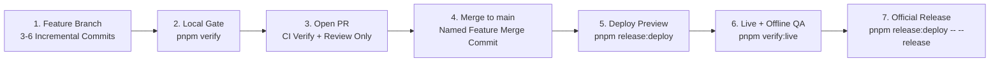

# Engineering, Release & Multi-Agent Workflow

Simple Budget follows a production software engineering workflow so both human contributors and AI agents
work with clear boundaries, incremental story-telling commits, peer review, non-redundant CI/CD, post-deploy
live QA, and automated Semantic Versioning + release notes.

## 1. Canonical Repository & Live Deployment

- **GitHub Repository:** `TandyN/simple-budget-app` (`https://github.com/TandyN/simple-budget-app`)
- **Live PWA URL (GitHub Pages):** `https://tandyn.github.io/simple-budget-app/`
- **Live Version Metadata:** `https://tandyn.github.io/simple-budget-app/version.json`
- **GitHub Actions / Pages Cost:** Because `TandyN/simple-budget-app` is a public repository, GitHub Actions
  standard runners and GitHub Pages hosting are **100% free**. (All user budget data lives only on the user's
  device, never in the repo or on GitHub.)

> ⚠️ **Guardrail:** Agents must verify `git remote get-url origin` points to `TandyN/simple-budget-app`
> before pushing branches, creating PRs, or deploying.

## 2. Non-Negotiable Repository Policies

1. **Human-Only Section in `README.md`:**
   - Everything at the top of `README.md` under `# Human Description` (above `# Simple Budget`) belongs
     exclusively to the human owner.
   - Agents must **never** edit, reword, format, or delete anything above `# Simple Budget`.
   - `scripts/check-docs.sh` mechanically compares the `# Human Description` section against the most recent
     human commit (any commit without `(agent-generated)`) and fails the build if a single character changed.
2. **Incremental, Story-Telling Commits with `(agent-generated)`:**
   - Agents must commit **frequently as each logical sub-step of a feature is completed** (3–6 commits per task)
     rather than making a single 2,000-line commit at the end of a task.
   - Every commit authored by an AI agent **must** use Conventional Commits (`feat(scope): ... [Txx]`) and end
     its subject line (and its commit body, if multi-line) with `(agent-generated)`.
   - Human commits do **not** include `(agent-generated)`.
   - Use the `agent-commit` skill for every commit.
3. **Zero Extra Runtime Dependencies (`react` and `react-dom` only):**
   - When installed on the phone, the production bundle must be a pure React app.
   - `package.json` `"dependencies"` may contain **only** `react` and `react-dom` (enforced mechanically by
     `scripts/check-docs.sh`).
   - Storage uses the browser's native IndexedDB API (`src/data/` (planned until T03)) + native iOS `Application Support`,
     routing uses native hash routing, sheets use native `<dialog>`, icons use inline SVGs, styling uses native
     CSS custom properties, and offline support uses our standard Service Worker (`public/sw.js`).
   - Well-tested developer tools (`typescript`, `vite`, `vitest`, `@playwright/test`, `eslint`, `prettier`,
     `fast-check`, `fake-indexeddb`, `lefthook`) are allowed in `"devDependencies"` only.

## 3. Semantic Versioning & Automated Release Notes (`0.y.z` Pre-1.0 → `1.0.0`)

- During initial development (tasks T01–T13), versions follow SemVer `0.y.z`:
  - `feat(...)` commits bump the **minor** version (`0.1.0` → `0.2.0`).
  - `fix(...)`, `perf(...)`, `refactor(...)`, `docs(...)` commits bump the **patch** version (`0.1.0` → `0.1.1`).
- Upon completing T14 (Hardening & Release), the app bumps to **`1.0.0`**.
- `scripts/release-version.mjs` inspects all non-merge Conventional Commits since the last `v*` git tag
  (`git log <last-tag>..HEAD --no-merges`), calculates the next SemVer version, and formats categorized release
  notes (`Features`, `Bug Fixes`, `Refactoring & Performance`, `Tests & Quality`, `Documentation`,
  `Tooling & Maintenance`) into `CHANGELOG.md` and the GitHub Release without merge-commit noise.
- Every build embeds `__APP_VERSION__` in the UI status bar and emits `dist/version.json` with `{ version, commit, builtAt }`.

## 4. End-to-End Feature, QA & Release Lifecycle



1. **Branch & Incremental Commits:** Create a topic branch from `main` (`git checkout -b feat/T03-local-database`).
   Commit after each logical piece of the feature (`agent-commit`) so the commit history tells a clear story.
   Run fast checks (`pnpm docs:check && pnpm format:check && pnpm lint && pnpm typecheck && pnpm test`) before
   intermediate commits, and run the full `pnpm verify` gate before opening the PR.
2. **Open Pull Request (Verification Only):** Push the branch to `origin` and open a PR against `main` via `gh pr create`.
   No version bump or deployment happens on the PR.
3. **Independent Review & GitHub Actions CI:**
   - Run the `review-pr` skill (via a dedicated `reviewer` subagent) to inspect `gh pr diff` and post a structured review.
   - Run `gh pr checks <pr-number> --watch --repo TandyN/simple-budget-app` and wait for both the Ubuntu `verify` job
     and the macOS `ios-simulator` Xcode build job to succeed. If any CI job fails, inspect
     `gh run view <run-id> --repo TandyN/simple-budget-app --log-failed`, fix the issue on the branch, and re-verify.
4. **Merge with a Descriptive Feature Merge Subject:** Merge the PR into `main` keeping the incremental commit history
   (`--merge`) while naming the merge commit after the feature:
   ```bash
   gh pr merge <pr-number> --repo TandyN/simple-budget-app --merge --delete-branch \
     --subject "feat(<scope>): <feature summary> (#<pr-number>) [Txx] (agent-generated)"
   ```
   _(Pushing to `main` does not re-run the PR `verify` / `ios-simulator` CI jobs.)_
5. **Deploy Merged `main` & Run Post-Deploy Live QA:**
   - Run `pnpm release:deploy` (`bash scripts/deploy.sh`), which builds `dist/` and deploys it to `gh-pages`.
   - Run `pnpm verify:live` (`scripts/verify-live.mjs`), which waits until
     `https://tandyn.github.io/simple-budget-app/version.json` serves the merged commit SHA, verifies WebKit rendering at both
     `iphone-duo-folded` and `iphone-duo-unfolded` viewports, and reloads the live PWA in **offline mode**.
6. **Cut the Official SemVer Release & Release Notes:**
   - Once Live QA passes, run `pnpm release:deploy -- --release` (`bash scripts/deploy.sh --release`).
   - This automatically runs `scripts/release-version.mjs` to bump `package.json` and update `CHANGELOG.md` from the
     Conventional Commits, commits `chore(release): vX.Y.Z (agent-generated)` to `main`, deploys the version-stamped
     bundle to `gh-pages`, tags `vX.Y.Z` (triggering `ios-testflight` on GitHub Actions when Apple credentials are
     configured), and publishes the official GitHub Release notes.

## 5. Instant Rollback

If a live release ever needs to be rolled back:

```bash
pnpm release:rollback v0.1.0
```

`scripts/rollback.sh` checks out the target `v*` tag in a clean temporary worktree, builds and deploys it to
`gh-pages`, and runs `pnpm verify:live --expect-version 0.1.0` to confirm the rollback is live.

## 6. Multi-Agent Personas & Parallel Task Orchestration

Using the `orchestrate-tasks` skill, an orchestrator agent can define and coordinate three specialized subagent roles:

| Persona       | Role                                                                                                                  |
| ------------- | --------------------------------------------------------------------------------------------------------------------- |
| `implementer` | Works on an isolated branch (`Workspace: 'branch'` or `'share'`), makes incremental commits, writes tests, verifies.  |
| `reviewer`    | Read-only/review focus: audits `gh pr diff` against all golden rules, test readability, and zero-runtime-deps policy. |
| `release-qa`  | Merges approved PRs, deploys to GitHub Pages, runs `pnpm verify:live`, and cuts the official SemVer release.          |

Tasks without shared dependencies in `docs/plan/README.md` can be developed in parallel on separate branches:

- **Parallel Pair 1 (after T01):** `T02 → T03` (Domain Core & Local Database) in parallel with `T04` (Design System & App Shell).
- **Parallel Pair 2 (after T10):** `T11 → T13` (Tags & Insights) in parallel with `T12` (Calendar).
